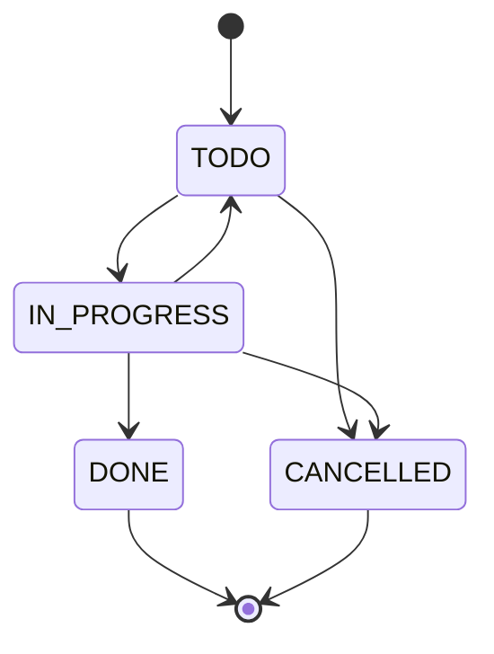
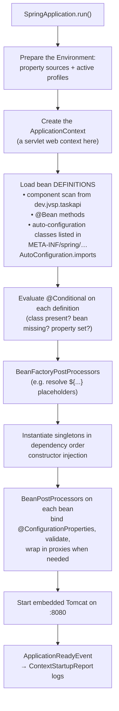
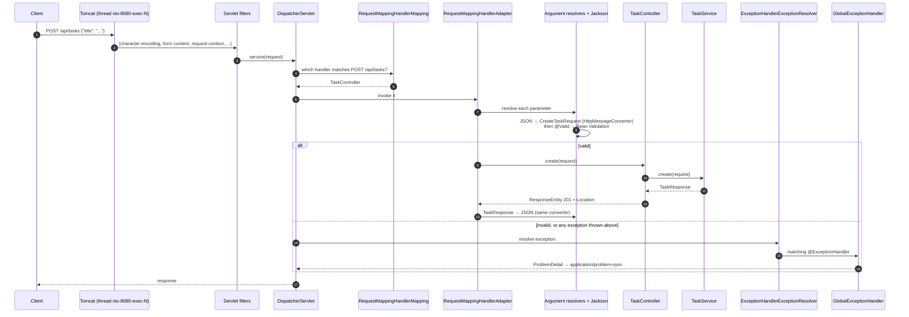
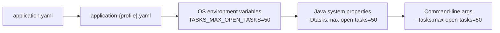

# 01 · REST fundamentals: a Task API

A small task tracker with an in-memory store. The domain is deliberately boring so that everything
interesting is about **what Spring does**: how the application context is built, how a JSON request
becomes a method call, how errors become RFC 9457 responses, and how configuration reaches your code.

## Goals

By the end of this chapter you can explain:

1. What happens between `SpringApplication.run(...)` and "Started TaskApiApplication".
2. What a bean is, how constructor injection resolves it, and why `@Configuration` classes are
   subclassed with CGLIB.
3. How auto-configuration decides what to create, and how to see each decision.
4. Every step a request takes through Spring MVC, and where validation and error handling hook in.
5. How `@ConfigurationProperties` records, profiles and property sources fit together.
6. Which kind of test (unit, context runner, web slice, full application) to use for what.

## The API

| Method | Path | Success | Errors |
|---|---|---|---|
| `POST` | `/api/tasks` | 201 + `Location` | 400 validation, 422 open-task limit |
| `GET` | `/api/tasks?status=TODO` | 200 list (status optional) | 400 unknown status |
| `GET` | `/api/tasks/{id}` | 200 | 404 |
| `PUT` | `/api/tasks/{id}` | 200 | 400, 404 |
| `PATCH` | `/api/tasks/{id}/status` | 200 | 400, 404, 409 forbidden transition |
| `DELETE` | `/api/tasks/{id}` | 204 | 404 |

Status rules (`TaskStatus.canTransitionTo`):



## Project layout

Package by feature: everything about tasks lives in `task`, and only the cross-cutting web concern
(the exception handler) sits outside it.

```
src/main/java/dev/jvsp/taskapi/
├── TaskApiApplication.java      @SpringBootApplication: the root of component scanning
├── TimeConfiguration.java       @Bean Clock
├── ContextStartupReport.java    dev profile only: lists our beans at startup
├── task/
│   ├── TaskController.java      HTTP ⇄ Java
│   ├── TaskService.java         business rules
│   ├── TaskRepository.java      ConcurrentHashMap store
│   ├── Task.java                internal model (record)
│   ├── TaskStatus.java / TaskPriority.java
│   ├── CreateTaskRequest.java / UpdateTaskRequest.java / ChangeStatusRequest.java / TaskResponse.java
│   ├── TaskProperties.java      @ConfigurationProperties("tasks")
│   └── TaskException.java       sealed: TaskNotFound / InvalidStatusTransition / OpenTaskLimitExceeded
└── web/
    └── GlobalExceptionHandler.java   @RestControllerAdvice → ProblemDetail
```

Most types are package-private. Only what another package needs (the exceptions for the handler,
the DTOs that form the API contract, the properties) is `public`. Spring does not need `public`:
it creates beans through reflection.

---

## 1. From `main` to a running application

`SpringApplication.run` does roughly this:



The key distinction: Spring first collects **bean definitions** (recipes: class, scope,
constructor arguments, conditions), and only then creates **beans** (instances) from them. Conditions
are evaluated on definitions, which is why an auto-configuration can quietly step aside before
anything is instantiated.

### Beans and dependency injection

A bean is an object whose lifecycle the container manages. You declare one in one of two ways:

- **A stereotype annotation on your class**: `@Component` or one of its specialisations
  (`@Service`, `@Repository`, `@Controller`/`@RestController`, `@Configuration`). Component scanning
  finds them below the package of `TaskApiApplication`.
- **A `@Bean` method** in a `@Configuration` class, for classes you cannot annotate.
  `TimeConfiguration` does this for `java.time.Clock`.

`TaskService` has one constructor taking `TaskRepository`, `TaskProperties` and `Clock`. Spring sees
a single constructor, looks up one bean of each parameter type, and calls it. No `@Autowired`
annotation is needed. If a type has no bean, or more than one, startup fails with a message naming
the parameter. That is the main reason constructor injection is the standard: missing dependencies
are found at startup, the fields are `final`, and `TaskServiceTest` builds the class with `new`.

**Scope.** Every bean here is a *singleton*: one instance per context, shared by all request
threads. So beans must be stateless or thread-safe. `TaskRepository` uses a `ConcurrentHashMap`, and
`TaskService.create` is `synchronized` because "count open tasks, then insert" must be atomic.

**`@Configuration` and CGLIB.** Run the app with the `dev` profile and look at the startup report:

```
ContextStartupReport : Application context ready with 290 bean definitions; this application's own beans:
ContextStartupReport :   contextStartupReport -> dev.jvsp.taskapi.ContextStartupReport
ContextStartupReport :   globalExceptionHandler -> dev.jvsp.taskapi.web.GlobalExceptionHandler
ContextStartupReport :   taskApiApplication -> dev.jvsp.taskapi.TaskApiApplication
ContextStartupReport :   taskController -> dev.jvsp.taskapi.task.TaskController
ContextStartupReport :   taskRepository -> dev.jvsp.taskapi.task.TaskRepository
ContextStartupReport :   taskService -> dev.jvsp.taskapi.task.TaskService
ContextStartupReport :   tasks-dev.jvsp.taskapi.task.TaskProperties -> dev.jvsp.taskapi.task.TaskProperties
ContextStartupReport :   timeConfiguration -> dev.jvsp.taskapi.TimeConfiguration$$SpringCGLIB$$0
```

Three things to notice:

- Seven of our beans, but **290** in total. The other ~280 come from auto-configuration.
- Bean names are the uncapitalised class name, except for `@ConfigurationProperties` beans, which
  are named `<prefix>-<fully qualified class>`.
- `TimeConfiguration` is not itself but a generated **subclass**. With the default
  `proxyBeanMethods = true`, Spring overrides every `@Bean` method so that calling `clock()` from
  another `@Bean` method returns the existing singleton instead of a new `Clock`. Spring Boot's own
  auto-configurations use `@Configuration(proxyBeanMethods = false)` because they never call one
  `@Bean` method from another and the subclass costs startup time. This "a bean may be a generated
  subclass" idea comes back in project 02, where `@Transactional` works through exactly such a proxy.

### Auto-configuration

`@SpringBootApplication` includes `@EnableAutoConfiguration`. It reads every
`META-INF/spring/org.springframework.boot.autoconfigure.AutoConfiguration.imports` file on the
classpath. In Spring Boot 4 these live in many small modules instead of one big jar:
`spring-boot-webmvc`, `spring-boot-jackson`, `spring-boot-tomcat`, `spring-boot-validation`, ... Each
starter (`spring-boot-starter-webmvc`) pulls in the library *and* its auto-configuration module.

Each auto-configuration class is guarded by conditions:

| Condition | Example from this app |
|---|---|
| `@ConditionalOnClass` | `JacksonAutoConfiguration` applies because `tools.jackson.databind.json.JsonMapper` (Jackson 3) is on the classpath |
| `@ConditionalOnMissingBean` | Boot creates a `JsonMapper` only if you did not define one. **Your bean wins, Boot's backs off.** |
| `@ConditionalOnBooleanProperty` | Boot's own `ProblemDetailsExceptionHandler` exists only with `spring.mvc.problemdetails.enabled=true`, *and* only `@ConditionalOnMissingBean(ResponseEntityExceptionHandler.class)`. Our `GlobalExceptionHandler` extends that class, so Boot's handler would back off even if the property were set. |

You can see every decision two ways:

- `./mvnw spring-boot:run -Dspring-boot.run.arguments=--debug` prints the **conditions evaluation
  report** at startup ("Positive matches" / "Negative matches").
- With the `dev` profile, `GET /actuator/conditions` returns the same as JSON (143 positive, 87
  negative matches when this chapter was written).

---

## 2. A request through Spring MVC



The `dev` profile sets `org.springframework.web.servlet` to DEBUG, so you can watch these steps
happen for real:

```
DispatcherServlet                 : POST "/api/tasks", parameters={}
RequestMappingHandlerMapping      : Mapped to dev.jvsp.taskapi.task.TaskController#create(CreateTaskRequest)
RequestResponseBodyMethodProcessor: Read "application/json;charset=UTF-8" to [CreateTaskRequest[title=Read chapter 1, ...]]
TaskService                       : Created task be5c0560-... with priority MEDIUM
HttpEntityMethodProcessor         : Using 'application/json', given [*/*] and supported [application/json, application/*+json]
HttpEntityMethodProcessor         : Writing [TaskResponse[id=be5c0560-..., ...]]
DispatcherServlet                 : Completed 201 CREATED
```

All of these components (`DispatcherServlet`, the handler mapping, the adapter, the message
converters backed by a Jackson 3 `JsonMapper`) are beans that the webmvc auto-configuration created.
`@RestController` itself is only `@Controller` + `@ResponseBody`: "write the return value into the
response body through a converter" instead of "resolve a view name".

### Validation

`spring-boot-starter-validation` puts Hibernate Validator on the classpath. That class condition
makes Boot register a `LocalValidatorFactoryBean`, which Spring MVC then uses for `@Valid`
parameters. Constraints live on the record components (`@NotBlank @Size(max = 200) String title`).
When validation fails, the argument resolver throws `MethodArgumentNotValidException` **before your
controller method is called**, so the controller never sees invalid input.

The same validator also validates `TaskProperties` at startup (`@Validated` on the record).

### Error handling with ProblemDetail (RFC 9457)

When anything throws, `DispatcherServlet` asks its `HandlerExceptionResolver`s for a response. The
one that matters is `ExceptionHandlerExceptionResolver`: it looks for the closest
`@ExceptionHandler`, first in the controller, then in `@ControllerAdvice` beans.
`GlobalExceptionHandler`:

- **extends `ResponseEntityExceptionHandler`**, which already handles every exception Spring MVC
  throws (malformed JSON, unsupported media type, type mismatch in `?status=SOMEDAY` or
  `/tasks/not-a-uuid`, unknown path, wrong method, ...). All of them become `ProblemDetail`.
- **overrides `handleMethodArgumentNotValid`** to add the list of field errors.
- **maps the sealed `TaskException` hierarchy** with an exhaustive `switch`. Add a fourth subtype
  and the handler stops compiling until you map it.
- **catches everything else** as a 500 with a generic message. The stack trace goes to the log,
  never to the client.

```json
HTTP/1.1 400
Content-Type: application/problem+json

{
  "type": "urn:jvsp:problem:validation-failed",
  "title": "Validation failed",
  "status": 400,
  "detail": "Invalid request content.",
  "errors": [
    {"field": "dueDate", "message": "must be a date in the present or in the future"},
    {"field": "title", "message": "must not be blank"}
  ]
}
```

`type` identifies the *kind* of problem: clients switch on it, never on `detail` text. In a company
it is usually a URL to the error's documentation; a URN is used here because there is no such site.
Extra members (`errors`, `taskId`, `limit`) are allowed by the RFC and come from
`ProblemDetail.setProperty`.

> **Spring Framework 7 change:** 6.x filled in `instance` (the request path) automatically. 7.x
> leaves it empty unless you set it, which is why the responses above have no `instance`.

Why the exceptions are not `@ResponseStatus`-annotated or `ErrorResponseException` subclasses: the
`task` package stays free of HTTP concepts, and the mapping to status codes lives in one place.

---

## 3. Configuration

### Where values come from

Spring builds an `Environment` from ordered **property sources**. When two of them define the same
key, the later one in this list wins:



(The full list has more entries; these are the ones you will actually use.) This is how one jar runs
everywhere: the jar contains sensible defaults, and each environment overrides them from the outside.
Containers and Kubernetes usually use environment variables.

### `@ConfigurationProperties` records

```java
@ConfigurationProperties("tasks")
@Validated
public record TaskProperties(@Positive int maxOpenTasks, @NotNull @DurationMin(days = 1) Duration defaultDueIn) {}
```

- **Constructor binding**: a record is bound by calling its canonical constructor, so the object is
  immutable.
- **Relaxed binding**: `tasks.max-open-tasks`, `tasks.maxOpenTasks` and `TASKS_MAXOPENTASKS` all bind
  to `maxOpenTasks`. Kebab case is the recommended form in files.
- **Type conversion**: `7d` becomes `Duration.ofDays(7)`.
- **Fail fast**: `tasks.max-open-tasks: 0` stops startup with a binding validation error, instead of
  surfacing on the first request (see `TaskPropertiesTest`).
- `@ConfigurationPropertiesScan` on the application class registers them; they are not `@Component`s.
- `spring-boot-configuration-processor` generates `META-INF/spring-configuration-metadata.json` at
  compile time, so the IDE autocompletes `tasks.*` in YAML and shows the Javadoc `@param` text.

Prefer this over `@Value("${tasks.max-open-tasks}")`: one typed, validated, testable object per
feature, instead of strings scattered through the code.

### Profiles

A profile is a named set of configuration and beans. `application-dev.yaml` is only loaded when
`dev` is active, and `ContextStartupReport` (`@Profile("dev")`) is only *registered* then.

| | default (no profile) | `dev` | `prod` |
|---|---|---|---|
| `tasks.max-open-tasks` | 100 | 5 (easy to hit by hand) | 10000 |
| Actuator endpoints | health, info | + beans, conditions, configprops, mappings | health, info |
| Logging | INFO | `dev.jvsp` DEBUG, Spring MVC DEBUG | WARN, `dev.jvsp` INFO |
| Startup report | no | yes | no |

Common practice: the default configuration is safe for production, and `dev` *adds* convenience.
Tests run with no profile, so they test what production gets.

### Logging

Spring Boot uses **SLF4J** as the API and **Logback** as the implementation, both brought in by
`spring-boot-starter-logging`. You only write `LoggerFactory.getLogger(...)` and set levels with
`logging.level.<logger>` keys, which are ordinary properties and can be overridden per profile or by
environment variable (`LOGGING_LEVEL_DEV_JVSP=trace`). Use parameterised messages (`"Created task
{}"`) so that disabled levels cost nothing. Structured JSON logging comes in project 04.

---

## 4. Testing

| Test | Kind | Spring context | What it proves |
|---|---|---|---|
| `TaskServiceTest` | unit | none | business rules, with a fixed `Clock` |
| `TaskStatusTest` | unit, parameterised | none | the transition table (`@CsvSource` text block) |
| `TaskPropertiesTest` | `ApplicationContextRunner` | a tiny one per test | binding, relaxed names, startup failure on invalid config |
| `TaskControllerTest` | `@WebMvcTest` slice | MVC beans only, `TaskService` mocked | URL mapping, JSON shape, validation, status codes, ProblemDetail |
| `TaskApiIT` | `@SpringBootTest(RANDOM_PORT)` | the whole application + real Tomcat | it all works together over real HTTP |

- **`@WebMvcTest`** includes `@Controller`, `@ControllerAdvice`, `Filter`, Jackson and validation
  beans, but not `@Service` or `@Repository`. `@MockitoBean` puts a Mockito mock into the context in
  their place. `MockMvcTester` calls `DispatcherServlet` directly, so no port is opened, and its
  AssertJ API (`assertThat(result).hasStatus(...)`, `.bodyJson().isLenientlyEqualTo(...)`) replaces
  the older `andExpect(...)` chains.
- **Context caching**: Spring's test framework caches application contexts by configuration. Test
  classes with the same setup share one context, which is why adding a `@MockitoBean` to a single
  class (a different configuration) costs a new context.
- **`RestTestClient`** (new in Spring Framework 7) is the synchronous counterpart of
  `WebTestClient`. With `@AutoConfigureRestTestClient` it is pointed at the random port.
- **Surefire vs failsafe**: `*Test` runs in `mvn test`; `*IT` runs in `integration-test` and is
  checked in `verify`. Slow tests do not slow down the edit-compile-test loop.
- **Mockito agent**: Mockito redefines classes through a Java agent. Attaching one at runtime is
  deprecated since JDK 21, so `pom.xml` passes `-javaagent:` to the test JVMs, as Mockito's own
  documentation recommends.

The `ERROR ... Unhandled exception` stack trace in the test output is expected: it comes from
`unexpectedErrorsDoNotLeakDetails`.

---

## How to run it

All commands run inside the dev container, in `01-rest-fundamentals/`.

```bash
./mvnw verify                                              # unit + slice + integration tests
./mvnw spring-boot:run -Dspring-boot.run.profiles=dev      # start on :8080 with the dev profile
```

In a second terminal:

```bash
# create
curl -i -X POST localhost:8080/api/tasks -H 'Content-Type: application/json' \
     -d '{"title": "Read chapter 1", "priority": "HIGH"}'

# list, filter
curl localhost:8080/api/tasks
curl 'localhost:8080/api/tasks?status=TODO'

# move it along (use the id from the create response)
curl -X PATCH localhost:8080/api/tasks/<id>/status -H 'Content-Type: application/json' -d '{"status": "IN_PROGRESS"}'

# errors
curl -X POST localhost:8080/api/tasks -H 'Content-Type: application/json' -d '{"title": ""}'
curl -X PATCH localhost:8080/api/tasks/<id>/status -H 'Content-Type: application/json' -d '{"status": "TODO"}'   # after DONE → 409

# look inside the application context (dev profile only)
curl localhost:8080/actuator/beans
curl localhost:8080/actuator/conditions
curl localhost:8080/actuator/configprops
curl localhost:8080/actuator/mappings
```

Run the packaged jar the way a server would:

```bash
./mvnw -DskipTests package
SPRING_PROFILES_ACTIVE=prod TASKS_MAX_OPEN_TASKS=3 java -jar target/rest-fundamentals-0.0.1-SNAPSHOT.jar
```

Port 8080 is forwarded by the dev container, so `http://localhost:8080/api/tasks` also works from a
browser or Postman on Windows.

### Frontend

`frontend/` is an Angular 22 app (standalone components, signals, `httpResource`, Signal Forms,
zoneless) for clicking through the API instead of using curl. Start the backend with the `dev`
profile as above, then in a second terminal:

```bash
cd frontend
npm install        # first time only
npm start          # http://localhost:4200 (forwarded to Windows)
npm test           # Vitest, run with:  npm test -- --watch=false
npm run build
```

The dev server proxies `/api` and `/actuator` to `:8080` (`proxy.conf.json`). The browser therefore
sees a single origin and no CORS is involved; CORS gets its own section in project 03. Because the
proxy forwards the original `Host` header, the `Location` header that
`ServletUriComponentsBuilder.fromCurrentRequest()` builds points at `:4200`: Spring builds URLs from
the request it receives, not from its own port.

| Screen | Spring behaviour it shows |
|---|---|
| **Tasks**: create form | `@Valid` + Bean Validation. Untick "Validate in the browser too" and submit an empty title or a past date: the 400 ProblemDetail's `errors` appear on the matching inputs, marked *server*. Create a 6th open task to get the 422 from `tasks.max-open-tasks: 5`. |
| **Tasks**: list filter | `@RequestParam TaskStatus` conversion (`?status=DONE`). |
| **Task**: status buttons | `TaskStatus.canTransitionTo`. The "forbidden" buttons send the transition anyway, to show the 409 and its extension members (`currentStatus`, `requestedStatus`). |
| **Task**: edit form | PUT with `@NotNull` fields. Open `/tasks/not-a-uuid` to see the type-mismatch 400 from `ResponseEntityExceptionHandler`. |
| **Application context** | `/actuator/beans` (our 7 beans of ~290, the CGLIB `TimeConfiguration`), `conditions` (what auto-configuration applied or backed off from), `mappings` (what `RequestMappingHandlerMapping` registered), `configprops` (the bound `TaskProperties`). |
| **HTTP exchanges** drawer | Every request and response: status, `Content-Type` (`application/json` vs `application/problem+json`), `Location`, bodies. |

---

## Exercises

Hints only. Each one should end with `./mvnw verify` passing.

1. **Overdue tasks.** Add `GET /api/tasks/overdue`: open tasks whose due date is before today.
   *Hints:* "today" must come from the injected `Clock`, never `LocalDate.now()`. Put the filtering in
   the repository or the service and test it in `TaskServiceTest` with `Clock.fixed(...)`. Watch the
   order of `@GetMapping("/{id}")` and your new mapping. Does Spring care? (Look at how
   `RequestMappingHandlerMapping` ranks a literal path against a pattern.)

2. **A custom constraint.** Reject due dates that fall on a weekend, with the message "must be a
   working day".
   *Hints:* an annotation meta-annotated with `@Constraint(validatedBy = ...)`, and a
   `ConstraintValidator<YourAnnotation, LocalDate>`. Remember that `null` is valid by convention
   (that is `@NotNull`'s job). You should not have to touch `GlobalExceptionHandler`; check that the
   new error appears in `errors` in a `TaskControllerTest` case.

3. **Freeze time in the integration test.** Make `TaskApiIT` assert the exact `dueDate` of a task
   created without one.
   *Hints:* you need a different `Clock` bean in that test only. Bean definition overriding is
   disabled by default in Boot (`spring.main.allow-bean-definition-overriding`). Find the test
   annotation in `org.springframework.test.context.bean.override` that replaces a bean by type. How
   does this change context caching?

4. **Make the default priority configurable.** Add `tasks.default-priority` to `TaskProperties` and
   use it instead of the hard-coded `MEDIUM`.
   *Hints:* enums bind case-insensitively (`high` works). Add a `TaskPropertiesTest` case for an
   invalid value and read the failure message. Then look at `target/classes/META-INF/spring-configuration-metadata.json`.

5. **Watch auto-configuration back off.** Make the API reject unknown JSON properties
   (`{"title": "x", "colour": "red"}` → 400), first with a single property in `application.yaml`, then
   instead by declaring a bean that customises Boot's `JsonMapper` builder.
   *Hints:* search the configuration properties appendix for `spring.jackson.deserialization`. For the
   bean, find the `...BuilderCustomizer` interface in `spring-boot-jackson`. Compare
   `/actuator/conditions` before and after defining your own `JsonMapper` bean outright. Which Boot
   beans disappear, and which settings stop working?

---

## Read next

Spring Framework (the container and MVC):
- [The IoC container and beans](https://docs.spring.io/spring-framework/reference/core/beans/introduction.html)
- [Dependency injection, constructor-based](https://docs.spring.io/spring-framework/reference/core/beans/dependencies/factory-collaborators.html)
- [`@Configuration` and full vs lite mode (the CGLIB subclass)](https://docs.spring.io/spring-framework/reference/core/beans/java/configuration-annotation.html#beans-java-further-information-java-config)
- [DispatcherServlet](https://docs.spring.io/spring-framework/reference/web/webmvc/mvc-servlet.html) and its [processing sequence](https://docs.spring.io/spring-framework/reference/web/webmvc/mvc-servlet/sequence.html)
- [Error responses and ProblemDetail](https://docs.spring.io/spring-framework/reference/web/webmvc/mvc-ann-rest-exceptions.html)
- [Validation in controllers](https://docs.spring.io/spring-framework/reference/web/webmvc/mvc-controller/ann-validation.html)
- [MockMvcTester (AssertJ integration)](https://docs.spring.io/spring-framework/reference/testing/mockmvc/assertj.html), [RestTestClient](https://docs.spring.io/spring-framework/reference/testing/resttestclient.html)

Spring Boot:
- [SpringApplication: startup, events, failure analysis](https://docs.spring.io/spring-boot/reference/features/spring-application.html)
- [Auto-configuration, and replacing it](https://docs.spring.io/spring-boot/reference/using/auto-configuration.html#using.auto-configuration.replacing)
- [Condition annotations](https://docs.spring.io/spring-boot/reference/features/developing-auto-configuration.html#features.developing-auto-configuration.condition-annotations) and [testing with ApplicationContextRunner](https://docs.spring.io/spring-boot/reference/features/developing-auto-configuration.html#features.developing-auto-configuration.testing)
- [Externalized configuration](https://docs.spring.io/spring-boot/reference/features/external-config.html): [constructor binding](https://docs.spring.io/spring-boot/reference/features/external-config.html#features.external-config.typesafe-configuration-properties.constructor-binding), [relaxed binding](https://docs.spring.io/spring-boot/reference/features/external-config.html#features.external-config.typesafe-configuration-properties.relaxed-binding), [validation](https://docs.spring.io/spring-boot/reference/features/external-config.html#features.external-config.typesafe-configuration-properties.validation)
- [Profiles](https://docs.spring.io/spring-boot/reference/features/profiles.html) and [profile-specific files](https://docs.spring.io/spring-boot/reference/features/external-config.html#features.external-config.files.profile-specific)
- [Logging](https://docs.spring.io/spring-boot/reference/features/logging.html)
- [Spring MVC error handling in Boot](https://docs.spring.io/spring-boot/reference/web/servlet.html#web.servlet.spring-mvc.error-handling)
- [Testing: MVC slice tests](https://docs.spring.io/spring-boot/reference/testing/spring-boot-applications.html#testing.spring-boot-applications.spring-mvc-tests) and [tests with a running server](https://docs.spring.io/spring-boot/reference/testing/spring-boot-applications.html#testing.spring-boot-applications.with-running-server)
- [Actuator endpoints](https://docs.spring.io/spring-boot/reference/actuator/endpoints.html)
- [Spring Boot 4.0 migration guide](https://github.com/spring-projects/spring-boot/wiki/Spring-Boot-4.0-Migration-Guide) (the modular starters and Jackson 3)

Standards:
- [RFC 9457: Problem Details for HTTP APIs](https://www.rfc-editor.org/rfc/rfc9457)
- [Mockito: adding the agent to the build](https://javadoc.io/doc/org.mockito/mockito-core/latest/org.mockito/org/mockito/Mockito.html#0.3)
