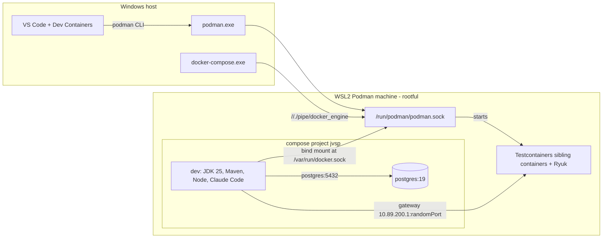

# jvsp: Java Spring, learned by building

A Spring Boot learning monorepo. Each numbered folder (`01-…` to `05-…`) is a standalone Spring
Boot application with its own chapter-style README. The plan is in [CURRICULUM.md](CURRICULUM.md).

Everything (JDK, Maven, Node, Claude Code, PostgreSQL) runs in containers. Nothing Java-related is
installed on the Windows host.

---

## Chosen versions (verified 2026-11-25)

| Component | Version | Why |
|---|---|---|
| Spring Boot | **4.2.0** | Latest GA. Maven Central `maven-metadata.xml` lists `<release>4.2.0</release>` and start.spring.io defaults to `4.2.0.RELEASE`. The only newer entry, 4.2.1, is a SNAPSHOT. |
| Java | **25** (LTS) | Spring Boot 4.2.0 "requires at least Java 17 and is compatible with versions up to and including Java 27". Java 27 is **not** an LTS release (the next LTS after 25 is 29), so 25 stays the LTS choice, as instructed. |
| Maven | **3.10.2** | Apache Maven's "recommended version for all users". Maven 4 is only 4.0.0-rc-7 and marked "NOT safe for production use". Each project pins its version through the Maven Wrapper. |
| PostgreSQL | **19** (19.0) | Latest stable major, released 2026-11-19. Caveat: it is days old, so Flyway may log "newer than the latest tested version" warnings. If a tool refuses it, switch the image to `postgres:18` (18.7, the most mature supported line). |
| Node.js | **26 LTS** ("Lithium") | Current LTS line. Not needed by Spring, but needed for tooling and requested. |
| Claude Code | latest, native installer | Anthropic's officially recommended install method (`curl -fsSL https://claude.ai/install.sh \| bash`). It auto-updates. |
| Base image | `mcr.microsoft.com/devcontainers/java:3-25-trixie` | Microsoft's dev container image: Debian 13, JDK 25, non-root `vscode` user with sudo, git. |

Testcontainers, JUnit, Hibernate, Flyway and the other library versions are **not** chosen by
hand. They come from the Spring Boot BOM (`spring-boot-dependencies`) in each project, which is the
whole point of Spring Boot's dependency management.

---

## How the environment fits together



Design decisions that differ from a typical Docker Desktop tutorial:

1. **The image is built by `podman build`, not by Compose.** Compose v5 no longer has its own
   builder: it delegates every build to BuildKit/Bake (buildx), and the Podman engine does not
   provide BuildKit. So `devcontainer.json` uses `initializeCommand` to run `podman build` on the
   host (Podman builds with buildah), and `compose.yaml` only references the finished image
   (`pull_policy: never`). For the same reason **no Dev Container Features are used**: features
   are built with BuildKit-specific syntax. JDK, Maven, Node and Claude Code are installed by the
   [Dockerfile](.devcontainer/Dockerfile) instead.
2. **Socket: `/run/podman/podman.sock`.** In a rootful Podman machine this is the real API socket
   created by systemd's `podman.socket` unit. The Windows pipe `//./pipe/docker_engine` forwards to
   it. `/var/run/docker.sock` inside the machine is only an optional compatibility symlink, and if
   a bind source is missing, a directory gets created in its place and the failure is confusing.
   The socket is mounted **at** `/var/run/docker.sock` inside the dev container, where every
   Docker client looks for it by default.
3. **Socket permissions.** The bind-mounted socket keeps the Podman machine's ids: owner root,
   group **gid 10** (`wheel` on the machine's Fedora-based distro, displayed as `uucp` inside this
   Debian container), mode `0660`. That gid is only known at runtime, so the container starts
   with a root step, [docker-socket-access.sh](.devcontainer/docker-socket-access.sh), that adds
   `vscode` to a group with the socket's gid, then runs `sleep infinity`. VS Code attaches
   afterwards as `vscode`, so every terminal has the group. The socket itself is never chmod-ed
   (that would modify the Podman VM).
4. **Testcontainers settings** (each one is explained in [compose.yaml](.devcontainer/compose.yaml)):
   `DOCKER_HOST`, `TESTCONTAINERS_DOCKER_SOCKET_OVERRIDE=/run/podman/podman.sock` (the path Ryuk
   mounts is resolved by the engine, inside the VM), `TESTCONTAINERS_HOST_OVERRIDE=10.89.200.1`
   (test containers are siblings whose ports are published on the VM; Testcontainers cannot
   detect it is inside a Podman container because Podman creates `/run/.containerenv`, not
   `/.dockerenv`; and `host.containers.internal` resolves to 192.168.127.1, the *Windows* side of
   the machine's network, where those ports are not published. So the value is the compose
   network's gateway, which is the VM itself, and the network's subnet is pinned in
   `compose.yaml` to keep that address stable), and `TESTCONTAINERS_RYUK_CONTAINER_PRIVILEGED=true` (SELinux in the VM).
   `TESTCONTAINERS_RYUK_DISABLED` is **not** set: that is only required for rootless Podman.
5. **The parent folder is mounted.** `jvsp` lives inside the `learn` git repository, so
   `compose.yaml` mounts `..\..` (the repo root) at `/workspaces/learn`, and the workspace
   is `/workspaces/learn/jvsp`. That way git works inside the container. If you ever move `jvsp`
   into its own repository, change that mount to `..` and `workspaceFolder` accordingly.

---

## Prerequisites (Windows host)

- Podman Desktop 1.31+ with Podman 6.2+, and a **rootful** Podman machine that is running:
  ```powershell
  podman machine list
  podman machine inspect --format "{{.Rootful}}"     # must print: true
  ```
  To switch an existing machine to rootful:
  `podman machine stop; podman machine set --rootful; podman machine start`.
- Give the machine enough memory for a JVM, PostgreSQL and Testcontainers (8 GB is comfortable):
  `podman machine stop; podman machine set --memory 8192; podman machine start`.
- Docker compatibility enabled in Podman Desktop (Settings → Docker Compatibility), so the
  `//./pipe/docker_engine` pipe exists. `podman compose version` must work.
- VS Code with the **Dev Containers** extension (`ms-vscode-remote.remote-containers`).
- Git for Windows. After cloning, the `.gitattributes` in this folder makes sure all scripts are
  checked out with LF line endings.

## VS Code user settings (required)

There is no `docker.exe` on the host, so Dev Containers must be told to use Podman. First find the
compose binary that `podman compose` delegates to:

```powershell
podman compose version
# first line looks like: >>>> Executing external compose provider "C:\...\docker-compose.exe" ...
```

Then open **Preferences: Open User Settings (JSON)** (`Ctrl+Shift+P`) and add:

```jsonc
{
  // Dev Containers runs `podman build/inspect/exec/...` instead of `docker ...`.
  "dev.containers.dockerPath": "podman",

  // The docker-compose.exe printed by `podman compose version` (escape the backslashes).
  // It talks to Podman through the default Docker pipe //./pipe/docker_engine.
  "dev.containers.dockerComposePath": "C:\\path\\printed\\above\\docker-compose.exe",

  // Only if you have a WSL distro with WSLg (e.g. Ubuntu): Dev Containers would bind-mount its
  // Wayland socket through a \\wsl.localhost\ UNC path, which Podman rejects.
  "dev.containers.mountWaylandSocket": false
}
```

Do not set a `DOCKER_HOST` environment variable on the host. docker-compose must use the default pipe.

## Open the project in the container

1. In VS Code: **File → Open Folder…** → select the `jvsp` folder (not `learn`; the
   `.devcontainer` folder is inside `jvsp`).
2. `Ctrl+Shift+P` → **Dev Containers: Reopen in Container**.
   The first run builds the image (JDK base image, Maven, Node, Claude Code: a few minutes), then
   starts `postgres` and `dev`. Click "show log" in the notification to watch progress.
3. A terminal opened in VS Code (`` Ctrl+` ``) now runs inside the `dev` container, as user `vscode`,
   in `/workspaces/learn/jvsp`.

To rebuild after changing the Dockerfile or compose file: **Dev Containers: Rebuild Container**.
The Maven repository, Claude Code login and database data are in named volumes and survive this.

## Run the smoke test

Inside the container terminal:

```bash
bash .devcontainer/smoke-test.sh
```

It checks: `java -version` (25), `mvn -version`, git/node/npm/claude/psql/docker, that the engine
socket answers `/_ping`, that a **sibling container's random port is reachable** through
`TESTCONTAINERS_HOST_OVERRIDE` (exactly what Testcontainers does), that a sibling container can
mount the engine socket (what Ryuk does), and that PostgreSQL answers. It ends with
`All checks passed.` or exits non-zero.

## Start Claude Code inside the container

```bash
claude
```

The first time, follow the sign-in prompt. If no browser opens, or it ends with a `localhost`
connection error, copy the login URL shown in the terminal into your Windows browser, sign in,
and paste the code back into the terminal. The login is stored in the `claude-config` volume
(`CLAUDE_CONFIG_DIR=/home/vscode/.claude`), so you only do this once per volume.

The Claude Code VS Code extension is also installed in the container. Both share the same login.

To continue the curriculum, type: `Continue with PHASE 2 from /CURRICULUM.md`.

## Connect to PostgreSQL

| From | Host | Port | User / password / database |
|---|---|---|---|
| dev container | `postgres` | 5432 | `dev` / `dev` / `dev` |
| Windows tools (via VS Code port forwarding) | `localhost` | 5432 (or the port VS Code shows in the Ports tab) | same |

These credentials are **development-only** throwaway values. They exist only in
`.devcontainer/compose.yaml` and must never be used anywhere else. Inside the container,
`psql` needs no arguments because `PGHOST`, `PGUSER`, etc. are set.

---

## Troubleshooting (Podman on Windows)

**"Dev Containers require Docker" / "docker not found".**
`dev.containers.dockerPath` is not set or `podman` is not on the PATH. Use the full path, e.g.
`"C:\\Program Files\\RedHat\\Podman\\podman.exe"`, and restart VS Code.

**"Docker Compose is configured to build using Bake, but buildx isn't installed", or a build error from Compose.**
Compose tried to build. This setup never builds in Compose, so the image is missing:
`initializeCommand` did not run or failed. Build it by hand in PowerShell, in the `jvsp` folder:
`podman build --tag localhost/jvsp-dev:latest --file .devcontainer/Dockerfile .devcontainer`.

**Container creation fails on a `\\wsl.localhost\...\wayland-0` mount.**
If you have a WSL distro with WSLg, Dev Containers bind-mounts its Wayland socket using a UNC path,
which Podman rejects. Add `"dev.containers.mountWaylandSocket": false` to your VS Code user
settings. GUI apps are not needed in this container.

**`initializeCommand` fails with `context must be a directory: "...\"..."`.**
VS Code runs it through `cmd.exe /c`, which mangles quoted paths. Keep the command's paths
relative and unquoted (it runs with the `jvsp` folder as working directory).

**`initializeCommand` fails, or `podman build` fails while pulling.**
Check that the machine is running (`podman machine start`) and that
`podman system connection list` shows the `...-root` connection as default.

**The bind mount `/run/podman/podman.sock` fails, or the smoke test says "is not a socket".**
The machine is probably rootless, so the rootful socket does not exist. Check it with:
`podman machine ssh ls -l /run/podman/podman.sock`. Switch to rootful (see Prerequisites).

**Smoke test: "no answer on /var/run/docker.sock" with a permission problem.**
Compare `stat -c '%g %a' /var/run/docker.sock` with `id -G`: your groups must include the
socket's gid. If not, the container was not recreated after a change: run **Dev Containers:
Rebuild Container** (a plain reload reuses the old container). If the socket mode is not `660`,
the group approach cannot work. Fix the setup before continuing.

**Smoke test: "could not reach <host>:<port>" in the sibling-port check.**
Testcontainers will hang in exactly the same way. `TESTCONTAINERS_HOST_OVERRIDE` must equal the
dev container's default gateway (`ip route | awk '/default/ {print $3}'`), which is pinned to
`10.89.200.1` by the `networks` section of `compose.yaml`. If the two differ, the container is
still on an old network: rebuild the container. Do not use `host.containers.internal` on Windows:
it points at the Windows side (192.168.127.1), where the ports are not published.

**"Pool overlaps with other one on this address space" when starting.**
Another Podman network already uses `10.89.200.0/24` (`podman network ls`, `podman network inspect`).
Pick another subnet in `compose.yaml` and update `TESTCONTAINERS_HOST_OVERRIDE` to its gateway.

**Testcontainers: "Could not find a valid Docker environment".**
Run `docker info` in the container. If that works but Testcontainers fails, check
`~/.testcontainers.properties` for a stale `docker.host` and delete it.

**Testcontainers: Ryuk fails to start or "Can not connect to Ryuk".**
The "Socket mount for Ryuk" smoke-test step shows the real error. Last resort (leaks containers
after crashed test runs, clean them with `docker ps -a`): set `TESTCONTAINERS_RYUK_DISABLED: "true"`.

**The workspace is empty, or the bind mount of `..\..` fails.**
Podman must translate the Windows path that docker-compose sends. If it cannot, replace
`source: ../..` with the WSL path of the folder in the Podman machine, e.g.
`/mnt/c/Users/<you>/Desktop/learn`.

**Builds are slow.**
The sources live on the Windows filesystem and are reached through a WSL2 file share, which is
slow for many small files (Maven `target/`). The Maven repository is already on a fast named
volume. If needed, use **Dev Containers: Clone Repository in Container Volume** to put the sources on
a volume too.

**`/usr/bin/env: 'bash\r': No such file or directory`.**
The file was checked out with CRLF. From the repository root:
`git add --renormalize . && git checkout -- .`, or re-save the file with LF in VS Code (status bar).

**PostgreSQL does not start after changing the major version.**
A data directory from one major version cannot be opened by another. This is dev data, so delete
the volume: stop the dev container, then `podman volume rm jvsp_postgres-data`.

**Claude Code asks you to sign in again after every rebuild.**
`CLAUDE_CONFIG_DIR` must equal the volume mount path (`/home/vscode/.claude`). Check with
`echo $CLAUDE_CONFIG_DIR`.

---

## Sources used for the decisions above

- Spring Boot releases: [Maven Central metadata](https://repo1.maven.org/maven2/org/springframework/boot/spring-boot/maven-metadata.xml), [start.spring.io metadata](https://start.spring.io/metadata/client), [System Requirements](https://docs.spring.io/spring-boot/system-requirements.html)
- [Apache Maven download page](https://maven.apache.org/download.cgi)
- [PostgreSQL versioning policy](https://www.postgresql.org/support/versioning/), [postgres image docs (PGDATA change in 18+)](https://hub.docker.com/_/postgres)
- [Node.js releases](https://nodejs.org/en/about/previous-releases)
- Claude Code: [Development containers](https://code.claude.com/docs/en/devcontainer), [Advanced setup / native installer](https://code.claude.com/docs/en/setup)
- [Testcontainers: supported Docker environments (Podman)](https://java.testcontainers.org/supported_docker_environment/), [Testcontainers configuration](https://java.testcontainers.org/features/configuration/)
- [Compose v5 always delegates builds to Bake (docker/compose#13058)](https://github.com/docker/compose/issues/13058), [podman compose forces DOCKER_BUILDKIT=0 (podman#26383)](https://github.com/podman-container-tools/podman/issues/26383)
- [Dev Container features fail with buildah on Podman](https://www.willvelida.com/posts/dev-containers-podman-vscode/), [Podman with VS Code Dev Containers](https://oneuptime.com/blog/post/2026-03-18-use-podman-vscode-dev-containers/view)
- [Microsoft dev container Java image](https://github.com/devcontainers/images/tree/main/src/java)
